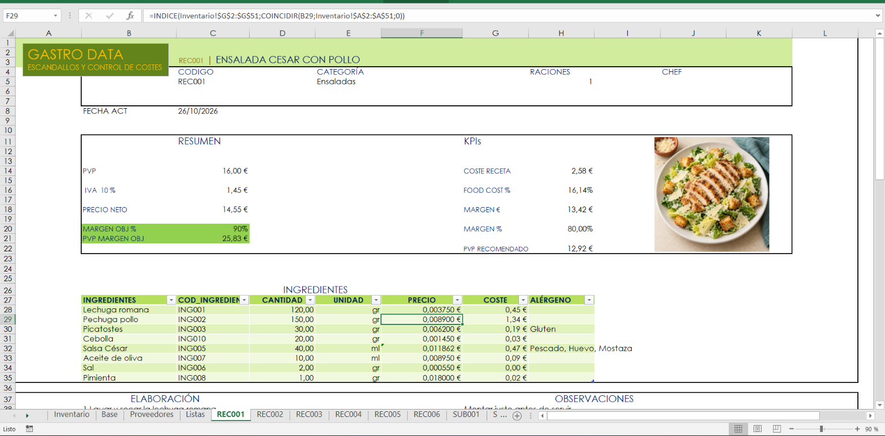
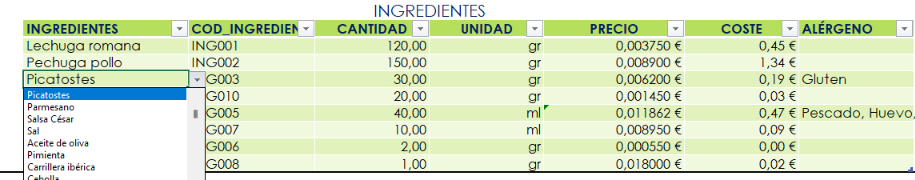

Módulo de gestión de costes para recetas, subrecetas, escandallos y control de costes mediante Excel y VBA.

# Documentación visual

## REC001 · Ensalada César con pollo

### Ficha y configuración

  

### Ingredientes y escandallo

  

### Costes y márgenes

  

### Configuración y análisis de precios

  

  

---

## SUB001 · Salsa César

### Ficha de elaboración

  

