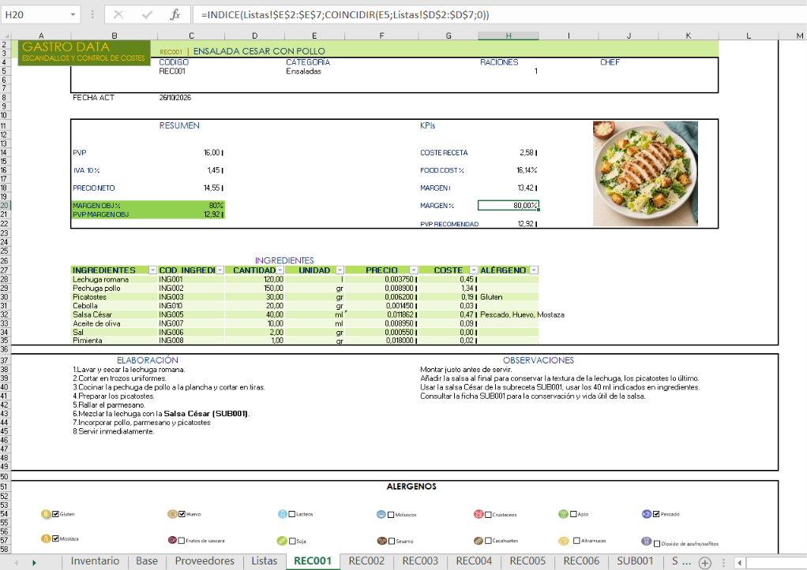
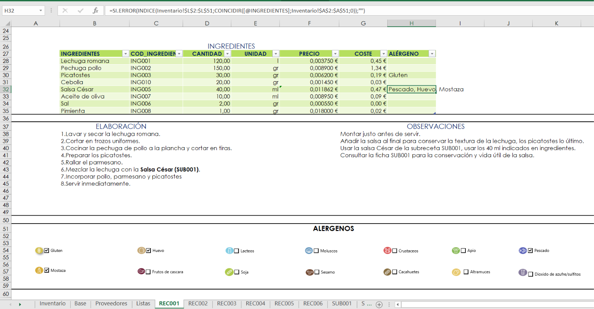
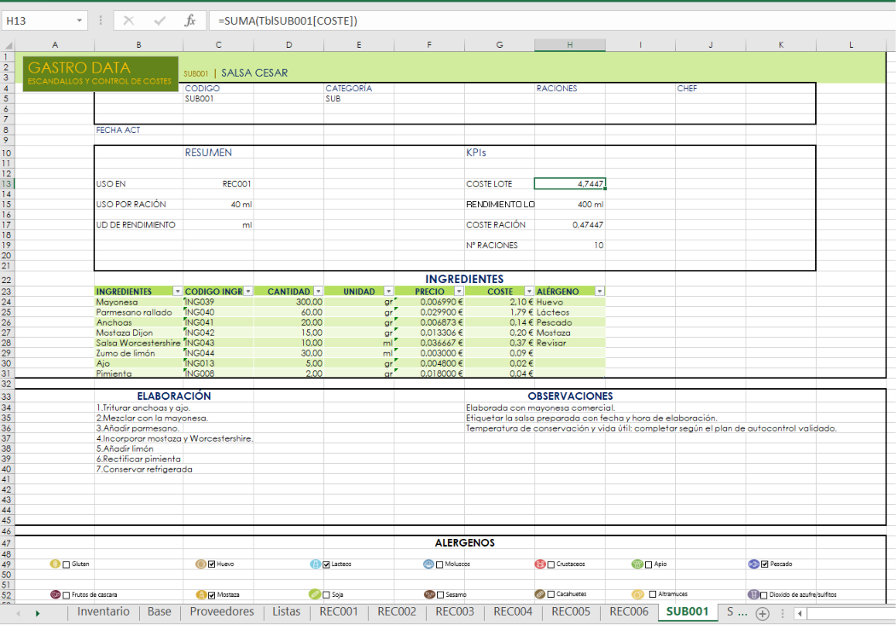

Módulo de gestión de costes para recetas, subrecetas, escandallos y control de costes mediante Excel y VBA.

# Documentación visual

## REC001 · Ensalada César con pollo

## SUB001 · Salsa César

