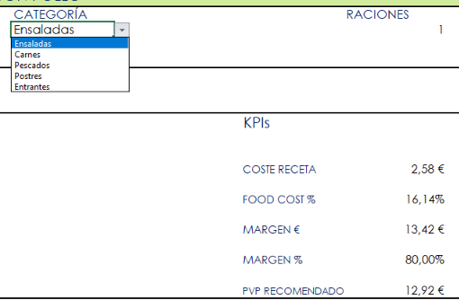

# GASTRODATA · MÓDULO 01
## Gestión de costes y escandallos

Sistema de gestión de recetas y subrecetas desarrollado mediante Excel y VBA, orientado al control de costes, análisis de márgenes y simulación de precios de venta en hostelería.

# 1. REC001 · Ensalada César con pollo

REC001 es una ficha de escandallo diseñada para calcular el coste de elaboración de una receta, controlar sus ingredientes y analizar sus principales indicadores económicos.

La ficha integra información sobre ingredientes, cantidades, costes, márgenes, precio de venta, elaboración y alérgenos.

### 1.1. Ficha y configuración

La cabecera identifica la receta mediante su código y categoría, permite establecer el número de raciones y recoge la información necesaria para configurar el análisis económico.

El sistema asigna automáticamente un margen predeterminado según la categoría del plato.

  

### 1.2. Ingredientes y escandallo

Los ingredientes se seleccionan mediante listas vinculadas a la hoja Inventario.

La ficha permite definir las cantidades y unidades utilizadas en cada elaboración. Excel calcula el coste de cada ingrediente a partir de su cantidad y precio unitario, obteniendo el coste total de la receta.

  

### 1.3. Indicadores económicos

El panel de indicadores permite consultar los principales datos económicos de la receta:

- Coste total de elaboración.
- Food Cost (%).
- Margen económico (€).
- Margen porcentual (%).
- Precio de venta recomendado.

Estos indicadores facilitan la evaluación económica de cada elaboración y permiten analizar diferentes escenarios comerciales.

  

### 1.4. Márgenes y simulación de precios

GastroData trabaja con dos parámetros independientes:

**Margen predeterminado por categoría**

Cada categoría tiene asociado un porcentaje de margen inicial:

| Categoría | Margen predeterminado |
|---|---:|
| Ensaladas | 80 % |
| Entrantes | 70 % |
| Carnes | 65 % |
| Pescados | 60 % |
| Postres | 75 % |

Estos porcentajes son parámetros configurados en el modelo y pueden modificarse según las necesidades del establecimiento.

**Margen objetivo**

El usuario puede introducir libremente un porcentaje de margen objetivo para simular diferentes escenarios de comercialización.

Excel calcula el precio de venta necesario para alcanzar ese objetivo a partir del coste de la receta.

Por ejemplo, una receta con un margen predeterminado del 70 % puede analizarse utilizando un margen objetivo del 90 %. En el escenario mostrado, el precio de venta calculado para ese objetivo es de 25,83 €.

Esta funcionalidad permite comparar escenarios y apoyar las decisiones de fijación de precios.

  

  

### 1.5. Elaboración y observaciones

La ficha incorpora instrucciones de elaboración y un apartado de observaciones para documentar aspectos relevantes de la preparación, conservación y servicio del plato.

Esta información complementa el escandallo económico con criterios operativos de producción.

### 1.6. Gestión de alérgenos

El sistema relaciona los ingredientes con sus alérgenos y actualiza automáticamente los indicadores correspondientes.

La identificación facilita la consulta de los principales alérgenos presentes en la receta.

Algunos ingredientes comerciales pueden requerir comprobación adicional, ya que su composición puede variar según el fabricante. En estos casos se utiliza la indicación «Revisar» hasta validar la información del producto concreto.

La automatización facilita la consulta, pero la información debe contrastarse con el etiquetado real de los productos antes de su utilización en un establecimiento.

---

# 2. SUB001 · Salsa César

SUB001 es una ficha independiente de elaboración que permite calcular el coste de producción de una subreceta y determinar su rendimiento.

La salsa se utiliza posteriormente como ingrediente en REC001, permitiendo imputar el coste correspondiente a la cantidad empleada en la receta principal.

### 2.1. Ficha de elaboración

La ficha recoge los ingredientes, cantidades, unidades, precios unitarios y costes asociados a la elaboración.

También permite consultar los siguientes indicadores:

- Coste total del lote.
- Rendimiento estimado.
- Coste por ración.
- Número aproximado de raciones.

En el ejemplo documentado, el rendimiento estimado es de 400 ml y la receta principal utiliza 40 ml por ración, equivalentes a unas 10 raciones por lote.

  

---

# 3. Tecnologías utilizadas

- **Microsoft Excel:** gestión de tablas, fórmulas, validaciones, cálculos y fichas de elaboración.
- **VBA:** automatización de procesos y actualización de indicadores de alérgenos.

# 4. Alcance y evolución

Esta primera entrega documenta las fichas REC001 y SUB001.

La selección de ingredientes está vinculada a la hoja Inventario. La centralización completa de costes y la trazabilidad de las subrecetas a través del inventario forman parte de las mejoras previstas.

Los costes y rendimientos utilizados en los ejemplos son simulados y no representan datos económicos de un establecimiento real.

# 5. Metodología y uso de inteligencia artificial

GastroData es un proyecto diseñado y desarrollado por mí a partir de mi experiencia en hostelería y de la identificación de necesidades operativas del sector.

Durante su desarrollo he utilizado herramientas de inteligencia artificial como apoyo para la consulta técnica, revisión de soluciones, resolución de dudas y mejora de la documentación.

Las decisiones funcionales, la implementación, las pruebas y la validación del proyecto forman parte de mi trabajo.
